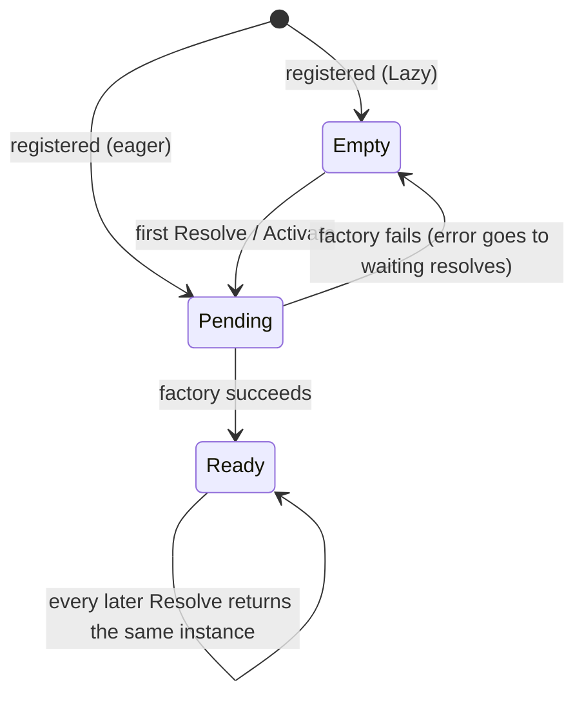

# Async Resolution

Real services start asynchronously. Databases connect, configuration is fetched, keys are loaded.
This container treats async creation as the normal case rather than an add-on. This page explains
the rules.

## One rule: `Resolve` is always async

`Resolve` always returns a promise, whether or not the service's factory is async. You never need
to know which of a service's dependencies need async setup, and a dependency can become async
later without changing any caller.

## The life of a singleton



- **Shared creation.** While a singleton is being created, every `Resolve` waits for the _same_
  creation. Ten concurrent requests open one database connection, not ten.
- **Failures aren't cached.** If creation fails, every resolve waiting on it receives the error,
  and the singleton goes back to _empty_. The next resolve tries again, so a dependency that was
  briefly down doesn't break the app forever.
- **Success is cached.** Once built, the instance is returned immediately from then on.

The same rules apply to each scope's instance of a scoped service.

## Eager registrations that fail

A singleton without `Lazy` is built at registration time. If that async attempt fails, the error
does **not** crash the process; it is held until something resolves the service.

- A `Resolve` made while that attempt is still running receives its result: the value, or the
  error.
- A `Resolve` made after it failed starts a new attempt. That also covers a factory that failed
  only because a dependency hadn't been registered yet.

`Activate()` builds every singleton that isn't ready yet: lazy ones and failed eager ones. It
reports all failures together, which makes it the simplest way to fail fast at startup.

## Transients

Each resolve of a transient calls its factory again, so concurrent resolves get separate
instances, and separate promises.

## Caveat: thenables are unwrapped

Because `Resolve` is `async`, a value with a `then` method (query builders, some ORM objects) is
treated like a promise and awaited:

```ts
import { IoCContainer, IoCToken } from '@fathym/ioc';

const query = { then: (resolve: (rows: string[]) => void) => resolve(['row']) };

const $Query = IoCToken<unknown>('Query');
const $Wrapped = IoCToken<{ query: typeof query }>('Wrapped');

const ioc = new IoCContainer();

ioc.RegisterValue($Query, query);
ioc.RegisterValue($Wrapped, { query }); // wrap it to keep the object itself

console.log(await ioc.Resolve($Query)); // [ "row" ]  (unwrapped)
console.log((await ioc.Resolve($Wrapped)).query === query); // true
```

Wrap such values in an object, or register a factory that returns a function creating them.

## What's Next

- Recipes for connections, retries and fail-fast startup:
  [async-initialization.md](../guides/async-initialization.md) _[How-to]_
- When creation needs itself: [cycles-and-errors.md](./cycles-and-errors.md) _[Explanation]_
- Cleaning up what was created: [disposal.md](./disposal.md) _[Explanation]_
