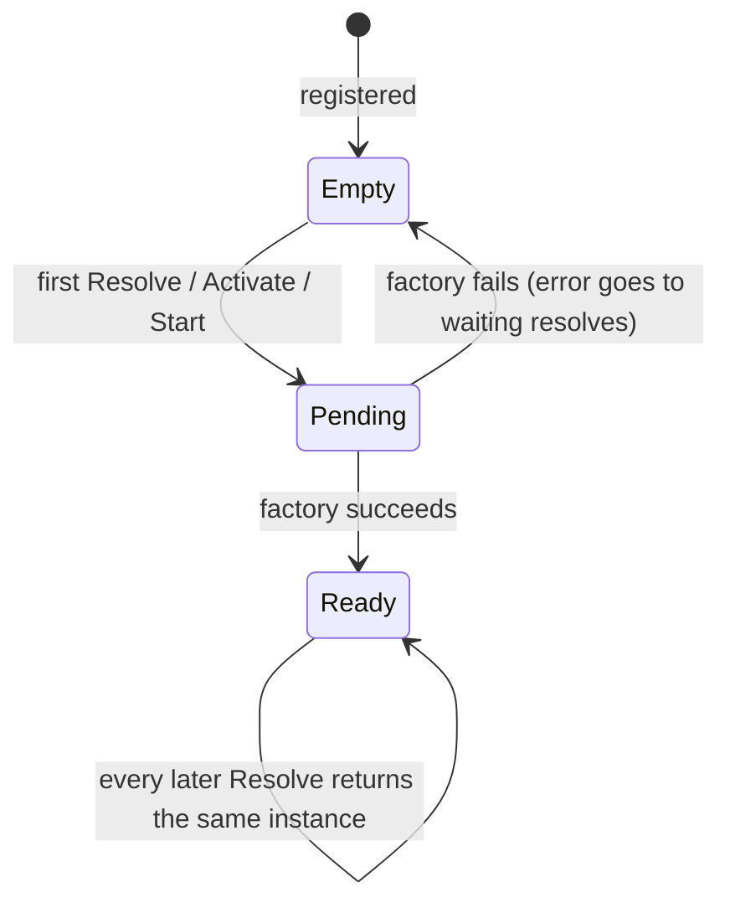

# Async Resolution

Real services start asynchronously. Databases connect, configuration is fetched, keys are loaded.
This container treats async creation as the normal case rather than an add-on. This page explains
the rules, and the two protections every container has against hangs.

## One rule: `Resolve` is always async

`Resolve` always returns a promise, whether or not the service's factory is async. You never need
to know which of a service's dependencies need async setup, and a dependency can become async
later without changing any caller.

## The life of a singleton



- **Nothing is built at registration.** The first `Resolve`, or `Activate()` / `Start()`, builds
  it.
- **Shared creation.** While a singleton is being created, every `Resolve` waits for the _same_
  creation. Ten concurrent requests open one database connection, not ten.
- **Failures aren't cached.** If creation fails, every resolve waiting on it receives the error,
  and the singleton goes back to _empty_. The next resolve tries again, so a dependency that was
  briefly down doesn't break the app forever.
- **Success is cached.** Once built, the instance is returned immediately from then on.

The same rules apply to each scope's instance of a scoped service. `Activate()` builds every
singleton that isn't ready and reports all failures together, in one `IoCActivationError`.

```ts
import { IoCContainer, IoCToken } from '@fathym/ioc';

const $Conn = IoCToken<{ id: number }, 'Conn'>('Conn');

let opened = 0;

const ioc = new IoCContainer().RegisterFactory($Conn, async () => {
  await new Promise((resolve) => setTimeout(resolve, 5));

  return { id: ++opened };
});

const [a, b] = await Promise.all([ioc.Resolve($Conn), ioc.Resolve($Conn)]);

console.log(a === b, opened); // true 1
```

## Transients

Each resolve of a transient calls its factory again, so concurrent resolves get separate
instances, and separate promises.

## Following the chain across `await`

The container tracks every resolution chain (`Service -> Repo -> Db`), to detect cycles and to
name the path in errors. Factories receive a view of the container that carries the chain, so
resolving through the factory's parameter is always followed, across any number of `await`s. A
cycle through the parameter throws `IoCCircularDependencyError` at once.

A factory that resolves through a container it **captured** from the outer scope is followed by
the **automatic async context**. Where the runtime offers `AsyncLocalStorage` (Deno, Node.js
20.16+ and Bun), the container uses it on its own, with no import and no option. It gives:

- **resolution paths in errors** (`No service is registered for Db. Resolution path: Repo.`),
  even after an `await`;
- **observed dependencies** (`Describe()`'s `Observed`) for factories without `Deps`.

It **never reports a cycle after an `await`**, though. There, the async context can't tell code
the build awaits from a callback the build started (a timer, a server's request handler), and
guessing would break valid code. So a real cycle through captured containers after an `await`
fails at the pending timeout instead, with `IoCResolveTimeoutError` naming what is pending and
pointing at captured containers:

```ts
import { IoCContainer, IoCToken, isIoCError } from '@fathym/ioc';

const $A = IoCToken<number, 'A'>('A');
const $B = IoCToken<number, 'B'>('B');

const ioc = new IoCContainer({ PendingTimeoutMs: 50 });

// Both factories use the captured `ioc` after an await: a timeout, not a cycle error.
ioc.RegisterFactory($A, async () => {
  await Promise.resolve();

  return (await ioc.Resolve($B)) + 1;
});

ioc.RegisterFactory($B, async () => {
  await Promise.resolve();

  return (await ioc.Resolve($A)) + 1;
});

try {
  await ioc.Resolve($A);
} catch (err) {
  console.log(isIoCError(err, 'IOC_RESOLVE_TIMEOUT')); // true: A did not finish within 50ms
}

// Through the parameter, the same cycle throws at once.
const fixed = new IoCContainer()
  .RegisterFactory($A, async (c) => {
    await Promise.resolve();

    return (await c.Resolve($B)) + 1;
  })
  .RegisterFactory($B, async (c) => {
    await Promise.resolve();

    return (await c.Resolve($A)) + 1;
  });

try {
  await fixed.Resolve($A);
} catch (err) {
  console.log(isIoCError(err, 'IOC_CIRCULAR_DEPENDENCY')); // true: A -> B -> A
}
```

- **Always resolve through the factory's parameter.** It works everywhere, reports cycles at
  once, and lets a scope's overrides reach the factory. See
  [cycles and errors](./cycles-and-errors.md#resolve-through-the-factorys-parameter).
- **The async context costs about 1 µs per factory call.** That is nothing for singletons, which
  build once. On a hot path that resolves many transients per request, measure it; if it matters,
  turn it off with `new IoCContainer({ AsyncContext: false })`.
- **Browsers, and Node.js 20 before 20.16, have no automatic async context.** There the container
  follows the parameter and the synchronous part of each factory, and the timeout covers the
  rest. On older Node.js 20 releases you can pass your own:
  `AsyncContext: new AsyncLocalStorage()` uses that instance instead.

## The pending timeout

Anything that never settles (a connection that never answers, a lock nobody releases) would hang
a resolve forever. Every container bounds that with `PendingTimeoutMs`, **30 000 ms by default**.
It applies to:

- every pending `Resolve`;
- every build during `Activate()` and `Start()`;
- each module's `OnStart` and `OnStop`;
- each instance's disposal in `Dispose()` (see [disposal](./disposal.md#order-and-errors)).

When it expires, the call fails with `IoCResolveTimeoutError` (`IOC_RESOLVE_TIMEOUT`), listing
what was still pending:

```ts
import { IoCContainer, IoCToken, isIoCError } from '@fathym/ioc';

const $Upstream = IoCToken<string, 'Upstream'>('Upstream');

const ioc = new IoCContainer({ PendingTimeoutMs: 50 }).RegisterFactory(
  $Upstream,
  () => new Promise<string>(() => {}), // never settles
);

try {
  await ioc.Resolve($Upstream);
} catch (err) {
  console.log(isIoCError(err, 'IOC_RESOLVE_TIMEOUT')); // true: Upstream did not finish within 50ms
}
```

Tune it to your slowest legitimate startup step: lower it in tests so a hang fails fast.
`PendingTimeoutMs: 0` turns it off. The timer only runs while something is pending; a built
singleton costs nothing.

When only one step is slow, give that step its own timeout instead of raising it for everything:

- **`TimeoutMs` on a registration** (`RegisterClass` or `RegisterFactory`) overrides
  `PendingTimeoutMs` for that service's builds (also during `Start()`) and resolves. `0` turns it
  off for that service.
- **`TimeoutMs` on a module** (`IoCModule` or `DefineModule`) overrides it for that module's
  `OnStart` and `OnStop`.

```ts
import { IoCContainer, IoCToken } from '@fathym/ioc';

const $Migrations = IoCToken<string, 'Migrations'>('Migrations');

const ioc = new IoCContainer({ PendingTimeoutMs: 20 }).RegisterFactory(
  $Migrations,
  async () => {
    await new Promise((resolve) => setTimeout(resolve, 50)); // a slow migration

    return 'migrated';
  },
  { TimeoutMs: 1_000 }, // this service may take up to a second
);

console.log(await ioc.Resolve($Migrations)); // migrated
```

A registration's `TimeoutMs` (or the container's `PendingTimeoutMs`) that isn't a finite number of
milliseconds throws `IoCRegistrationError`
(`TimeoutMs must be a number of milliseconds from 0 (off) to 2147483647 (about 24.8 days).`).

## Caveat: thenables are unwrapped

Because `Resolve` is `async`, a value with a `then` method (query builders, some ORM objects) is
treated like a promise and awaited:

```ts
import { IoCContainer, IoCToken } from '@fathym/ioc';

const query = { then: (resolve: (rows: string[]) => void) => resolve(['row']) };

const $Query = IoCToken<unknown, 'Query'>('Query');
const $Wrapped = IoCToken<{ query: typeof query }, 'Wrapped'>('Wrapped');

const ioc = new IoCContainer()
  .RegisterValue($Query, query)
  .RegisterValue($Wrapped, { query }); // wrap it to keep the object itself

console.log(await ioc.Resolve($Query)); // [ "row" ]  (unwrapped)
console.log((await ioc.Resolve($Wrapped)).query === query); // true
```

Wrap such values in an object, or register a factory that returns a function creating them.

## What's Next

- Recipes for connections, retries and fail-fast startup:
  [async-initialization.md](../guides/async-initialization.md) _[How-to]_
- When creation needs itself: [cycles-and-errors.md](./cycles-and-errors.md) _[Explanation]_
- Cleaning up what was created: [disposal.md](./disposal.md) _[Explanation]_
