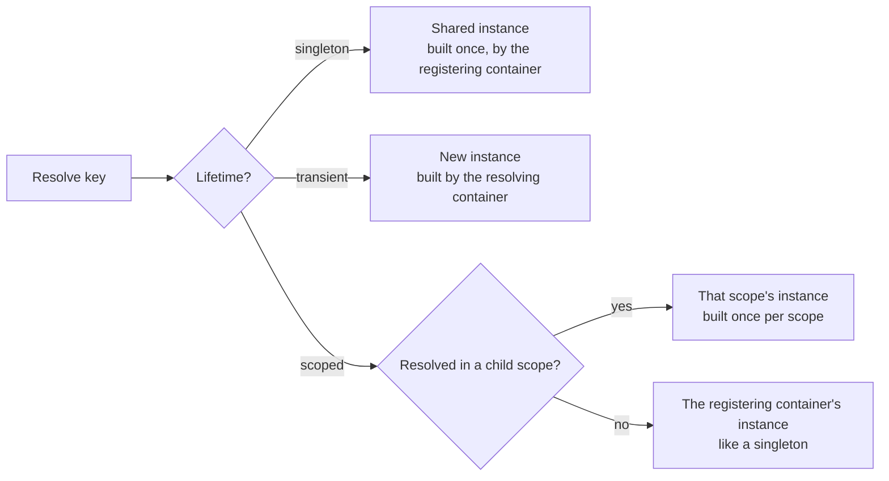

# Lifetimes

A registration's **lifetime** decides how many instances exist and how long they live. There are
three, and one table says almost everything about them.

| Lifetime            | Instances                                                                      | Built when                                                                     | Factory receives                      | Disposed by                  |
| ------------------- | ------------------------------------------------------------------------------ | ------------------------------------------------------------------------------ | ------------------------------------- | ---------------------------- |
| singleton (default) | One per registration, shared by the container, its scopes and `CopyTo` targets | At registration, or on first resolve with `Lazy: true`                         | The container that registered it      | That container's `Dispose()` |
| `transient`         | A new one per resolve                                                          | On every resolve                                                               | The container (or scope) resolving it | Never: the caller owns it    |
| `scoped`            | One per scope                                                                  | On first resolve in each scope; in the registering container, like a singleton | The scope resolving it                | That scope's `Dispose()`     |



## Singleton

The default. One instance, created once and shared everywhere.

- **Eager by default.** A singleton is built _when you register it_. A synchronous error makes
  the registration call throw (and keeps any earlier registration). An async failure is kept until something
  resolves the service, and the next resolve after it settles retries.
- **`Lazy: true` defers creation** to the first resolve. Creation is shared by concurrent
  resolves and retried if it fails. Use `Activate()` to build lazy singletons at startup anyway.
- **Always built by the container that registered it.** Resolving a singleton from a scope still
  builds it in the registering container, with that container's registrations. That is what makes
  it safe to share.

## Transient

A new instance on every resolve. Use it for cheap, stateful objects (a request handler, a
builder) or when each caller needs its own.

- The factory receives **the container or scope doing the resolving**, so a transient resolved
  from a scope sees that scope's services and overrides.
- The container never disposes transients. Whoever resolved one owns it.

## Scoped

One instance per **scope** (see [scopes](./scopes.md)), typically one per HTTP request.

- In each child scope created with `CreateScope()`, the instance is built on first resolve and
  disposed with the scope.
- In the container where it was registered, it behaves like a singleton (built at registration
  unless `Lazy`).

```ts
import { IoCContainer } from '@fathym/ioc';

class RequestContext {
  public id = crypto.randomUUID();
}

const ioc = new IoCContainer();

ioc.RegisterClass(RequestContext, { Lifetime: 'scoped', Lazy: true });

const a = ioc.CreateScope();
const b = ioc.CreateScope();

console.log((await a.Resolve(RequestContext)) === (await a.Resolve(RequestContext))); // true
console.log((await a.Resolve(RequestContext)) === (await b.Resolve(RequestContext))); // false
```

## Captive dependency

A **captive dependency** is a longer-lived service holding on to a shorter-lived one. For example,
a singleton that keeps a scoped service would keep one request's data for the life of the app.

This container prevents the worst case by construction: singletons are always built by the
container that registered them, so they never receive a child scope's instance. `Validate()`
reports a singleton that _declares_ a scoped dependency, so you can make the singleton scoped or
transient instead. See the [guidelines](../guides/guidelines.md#captive-dependency).

## Choosing a lifetime

| Use…        | When the service…                                                   |
| ----------- | ------------------------------------------------------------------- |
| singleton   | is stateless or holds shared state (config, clients, pools, caches) |
| `scoped`    | holds per-request state (the request, the user, a unit of work)     |
| `transient` | is cheap and stateful per use, or depends on scoped services        |

## What's Next

- Child scopes and overrides: [scopes.md](./scopes.md) _[Explanation]_
- What happens when creation is async or fails:
  [async-resolution.md](./async-resolution.md) _[Explanation]_
- Who disposes what: [disposal.md](./disposal.md) _[Explanation]_
