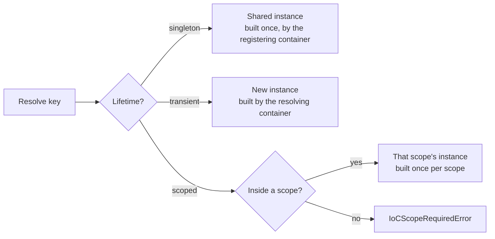

# Lifetimes

A registration's **lifetime** decides how many instances exist and how long they live. There are
three: singleton, transient and scoped. A scoped service can also be bound to a **level** you
declare, such as `tenant` or `request`.

| Lifetime            | Instances                                   | Built when                                 | Factory receives                      | Disposed by                  |
| ------------------- | ------------------------------------------- | ------------------------------------------ | ------------------------------------- | ---------------------------- |
| singleton (default) | One, shared by the container and its scopes | First resolve, or `Activate()` / `Start()` | The container that registered it      | That container's `Dispose()` |
| `transient`         | A new one per resolve                       | On every resolve                           | The container (or scope) resolving it | Never: the caller owns it    |
| `scoped`            | One per scope                               | First resolve in each scope                | The scope resolving it                | That scope's `Dispose()`     |
| `ScopeLevel: 'x'`   | One per scope of level `x`                  | First resolve inside that scope            | The scope of level `x`                | That scope's `Dispose()`     |

**Nothing is built at registration.** Every singleton is built on first use, or all at once by
`Activate()` and `Start()`, so registration order never matters.



## Singleton

The default. One instance, built once and shared everywhere.

- **Built on first resolve,** and shared by every concurrent resolve. A failed build isn't
  cached: the next resolve retries. See [async resolution](./async-resolution.md).
- **`Activate()` and `Start()` build every singleton** at once, so a broken service fails at
  startup rather than on the first request. A singleton registered with `OnDemand: true` is the
  exception: it is built on first resolve only, for resources only some code paths need (a CLI
  command's client, an optional integration). `Validate()` still checks its wiring.
- **Always built by the container that registered it.** Resolving a singleton from a scope still
  builds it in the registering container, with that container's registrations. That is what makes
  it safe to share.

## Transient

A new instance on every resolve. Use it for cheap, stateful objects (a request handler, a
builder) or when each caller needs its own.

- The factory receives **the container or scope doing the resolving**, so a transient resolved
  from a scope sees that scope's services and overrides.
- The container never disposes transients. Whoever resolved one owns it.

## Scoped

One instance per **scope** (see [scopes](./scopes.md)), typically one per request.

- In each scope created with `CreateScope()`, the instance is built on first resolve and disposed
  with the scope.
- Resolving a scoped service from the root container throws `IoCScopeRequiredError`
  (`IOC_SCOPE_REQUIRED`). Outside a scope it would silently act as one shared instance.

```ts
import { IoCContainer } from '@fathym/ioc';

class RequestContext {
  public id = crypto.randomUUID();
}

const ioc = new IoCContainer().RegisterClass(RequestContext, { Lifetime: 'scoped' });

await using a = ioc.CreateScope();
await using b = ioc.CreateScope();

console.log((await a.Resolve(RequestContext)) === (await a.Resolve(RequestContext))); // true
console.log((await a.Resolve(RequestContext)) === (await b.Resolve(RequestContext))); // false
```

## Scoped to a level

Declare the levels your application uses once, outermost first:
`new IoCContainer({ Levels: ['tenant', 'request'] })`. A registration with `ScopeLevel: 'tenant'`
then lives in the nearest `tenant` scope: every scope nested inside it shares that instance, and
it is disposed with that scope. `ScopeLevel` implies `Lifetime: 'scoped'`, so you don't write
both.

```ts
import { IoCContainer } from '@fathym/ioc';

class TenantDb {
  public id = crypto.randomUUID();
}

const ioc = new IoCContainer({ Levels: ['tenant', 'request'] })
  .RegisterClass(TenantDb, { ScopeLevel: 'tenant' });

await using acme = ioc.CreateScope({ Level: 'tenant' });

await using req1 = acme.CreateScope({ Level: 'request' });
await using req2 = acme.CreateScope({ Level: 'request' });

console.log((await req1.Resolve(TenantDb)) === (await req2.Resolve(TenantDb))); // true
```

A level that isn't declared throws `IoCLevelError` (`IOC_INVALID_LEVEL`), so a typo can't create
a lifetime nobody meant. [Scopes](./scopes.md#scope-levels) has the nesting rules.

## Captive dependencies

A **captive dependency** is a longer-lived service holding on to a shorter-lived one. A singleton
that kept a request's `CurrentUser` would serve one user's data to everyone.

Lifetimes rank from longest to shortest:

1. singleton;
2. each declared level, in order (`tenant`, then `request`);
3. unleveled `scoped`.

Transients have no rank of their own: they live as long as whatever holds them.

`Validate()` (and so `Start()`) reports a `captive` issue whenever a service depends, directly
**or through transients**, on a shorter-lived one:

```ts
import { IoCContainer } from '@fathym/ioc';

class RequestLog {
  public lines: string[] = [];
}

class Formatter {
  constructor(public log: RequestLog) {}
}

class TenantReport {
  constructor(public formatter: Formatter) {}
}

const ioc = new IoCContainer({ Levels: ['tenant', 'request'] })
  .RegisterClass(RequestLog, { ScopeLevel: 'request' })
  .RegisterClass(Formatter, { Deps: [RequestLog], Lifetime: 'transient' })
  .RegisterClass(TenantReport, { Deps: [Formatter], ScopeLevel: 'tenant' });

for (const issue of ioc.Validate({ Throw: false })) console.log(issue.Kind, issue.Message);
// captive tenant-scoped TenantReport depends on request-scoped RequestLog (through Formatter); …
```

The fix is one of:

- give the holder a shorter lifetime (`ScopeLevel: 'request'` here);
- or inject `IoCLazy(RequestLog)` and resolve it on each use, from the right scope.

Singletons are always built by the container that registered them, so the worst case can't
happen silently: a singleton never receives a scope's instance. Asking for one throws
`IoCScopeRequiredError` instead.

## Choosing a lifetime

| Use…                   | When the service…                                                     |
| ---------------------- | --------------------------------------------------------------------- |
| singleton              | is stateless or holds app-wide state (config, clients, pools, caches) |
| `ScopeLevel: 'tenant'` | holds one unit's resources (a tenant's connection, an agent's memory) |
| `scoped`               | holds per-request state (the request, the user, a unit of work)       |
| `transient`            | is cheap and stateful per use                                         |

## What's Next

- Child scopes, levels and overrides: [scopes.md](./scopes.md) _[Explanation]_
- What happens when creation is async or fails:
  [async-resolution.md](./async-resolution.md) _[Explanation]_
- Who disposes what: [disposal.md](./disposal.md) _[Explanation]_
