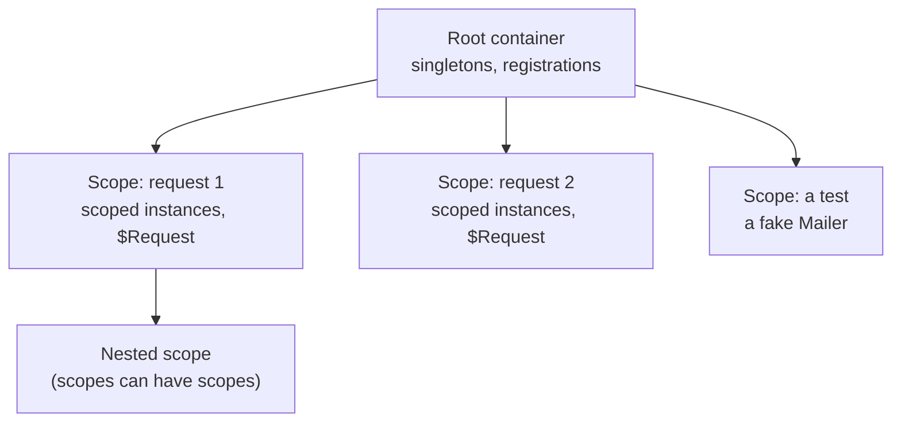

# Scopes

A **scope** is a child container you create with `ioc.CreateScope()`. It can resolve everything
its parent can, adds its own registrations on top, and owns the instances it creates. Scopes are
how you get per-request services, and how tests override one dependency without touching the
rest.

> **Warning:** A scope is not an HTTP request. It is whatever you create it for. Create one per
> request and it becomes a request scope; create one per test and it becomes a test sandbox.

## The scope tree



## How lookups work

When you resolve from a scope, the scope looks for the key and name in its own registrations
first, then in its parent's, and so on up the tree. **Nearest wins.** Nothing is copied when a
scope is created, and the parent keeps no reference to it. Creating thousands of scopes is cheap,
and a scope you drop is garbage-collected.

## What each lifetime does in a scope

| Lifetime  | Resolved from a scope                                                                |
| --------- | ------------------------------------------------------------------------------------ |
| singleton | The shared instance, built by the container that registered it                       |
| transient | A new instance; its factory receives the scope, so it sees the scope's registrations |
| scoped    | This scope's own instance, built on first resolve and disposed with the scope        |

## Overrides

Anything you register on a scope overrides the parent **for that scope only**:

```ts
import { IoCContainer, IoCToken } from '@fathym/ioc';

const $Greeting = IoCToken<string>('Greeting');

const ioc = new IoCContainer();

ioc.RegisterValue($Greeting, 'Hello');
ioc.RegisterFactory(
  IoCToken<string>('Message'),
  async (c) => `${await c.Resolve($Greeting)}, Ada`,
  {
    Lifetime: 'transient',
  },
);

const scope = ioc.CreateScope();

scope.RegisterValue($Greeting, 'Bonjour');

console.log(await scope.Resolve(IoCToken<string>('Message'))); // Bonjour, Ada
console.log(await ioc.Resolve(IoCToken<string>('Message'))); // Hello, Ada
```

The transient `Message` was registered on the root, but when it is resolved from the scope its
factory receives the scope, so it sees the scope's `$Greeting`.

> **Note:** Overrides reach **transient and scoped** services, and anything resolved directly
> from the scope. A **singleton** is always built by the container that registered it, so it never
> sees a scope's overrides. This is by design: one shared instance can't depend on one request.

## Scope levels

Real apps nest scopes: a tenant inside the app, a request inside a tenant, an agent inside a run.
Give a scope a level with `CreateScope({ Level })`, and bind a `scoped` registration to a level
with `ScopeLevel`. Its instance then lives in the nearest scope of that level, so every scope
nested inside shares it, and it is disposed with that scope:

```ts
import { IoCContainer } from '@fathym/ioc';

class TenantDb {
  public id = crypto.randomUUID();
}

class RequestLog {
  public lines: string[] = [];
}

const ioc = new IoCContainer()
  .RegisterClass(TenantDb, { Lifetime: 'scoped', ScopeLevel: 'tenant' })
  .RegisterClass(RequestLog, { Lifetime: 'scoped', Lazy: true });

await using acme = ioc.CreateScope({ Level: 'tenant' });

await using req1 = acme.CreateScope({ Level: 'request' });
await using req2 = acme.CreateScope({ Level: 'request' });

console.log((await req1.Resolve(TenantDb)) === (await req2.Resolve(TenantDb))); // true: one per tenant
console.log((await req1.Resolve(RequestLog)) === (await req2.Resolve(RequestLog))); // false: one per request
```

Resolving a level-bound service with no scope of its level above throws `IoCScopeRequiredError`,
whether or not the container is strict. Levels are plain strings: use whatever your app's units
are.

## Isolating services in a scope

A scope shares its parent's singletons. When a sub-unit needs its own copy of a few of them (an
agent's memory, a command group's settings), `scope.Isolate(...keys)` registers those keys again
in the scope with the parent's recipe. The scope then builds, caches and disposes its own
instance, and everything else stays shared:

```ts
import { IoCContainer } from '@fathym/ioc';

class Memory {
  public notes: string[] = [];
}

class Tools {}

const ioc = new IoCContainer()
  .RegisterClass(Memory, { Lazy: true })
  .RegisterClass(Tools, { Lazy: true });

await using planner = ioc.CreateScope({ Level: 'agent' }).Isolate(Memory);
await using writer = ioc.CreateScope({ Level: 'agent' }).Isolate(Memory);

(await planner.Resolve(Memory)).notes.push('plan');

console.log((await writer.Resolve(Memory)).notes); // []
console.log((await planner.Resolve(Tools)) === (await writer.Resolve(Tools))); // true
```

An isolated service's dependencies are resolved from the scope, so isolate them too when they
must be separate. Values can't be isolated; register the scope's own value instead.

## No bubbling

Some frameworks change a service's lifetime when it depends on a request-scoped one (NestJS calls
this "scope bubbling"). This container never changes a lifetime behind your back. If a singleton
declares a scoped dependency, `Validate()` reports it so you can choose.

## Disposing scopes

`await using scope = ioc.CreateScope()` disposes the scope when the block ends. A scope disposes
the instances it created: its scoped instances and the singletons registered on the scope itself.
It never disposes the parent's singletons. Disposing the root does not dispose its scopes,
because it doesn't track them, so dispose each scope where you create it. See
[disposal](./disposal.md).

## What's Next

- One scope per HTTP request, with any framework:
  [per-request-scopes.md](../guides/per-request-scopes.md) _[How-to]_
- Scopes as test sandboxes: [testing.md](../guides/testing.md) _[How-to]_
- Disposal rules: [disposal.md](./disposal.md) _[Explanation]_
