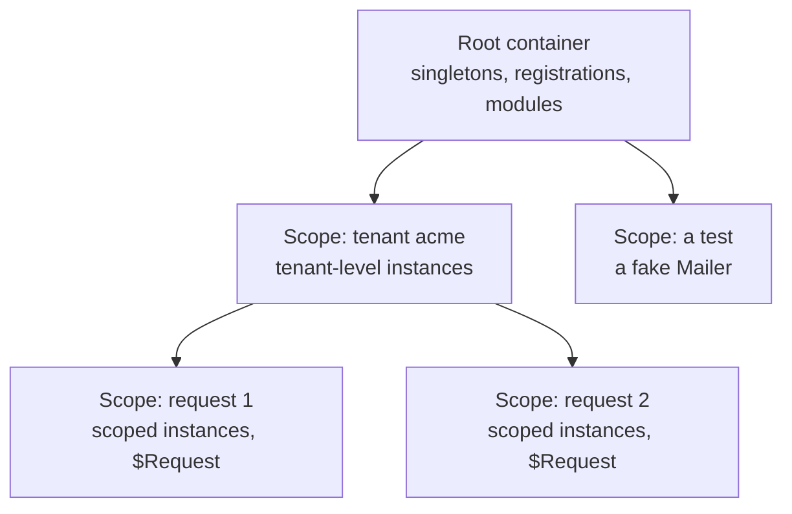

# Scopes

A **scope** is a child container you create with `ioc.CreateScope()`. It can resolve everything
its parent can, adds its own registrations on top, and owns the instances it creates. Scopes are
how you get per-request (or per-tenant, per-command, per-agent) services, and how a test swaps
one dependency without touching the rest.

> **Warning:** A scope is not an HTTP request. It is whatever you create it for. Create one per
> request and it becomes a request scope; create one per test and it becomes a test sandbox.

## The scope tree



## How lookups work

When you resolve from a scope, the scope looks for the key and name in its own registrations
first, then in its parent's, and so on up the tree. **Nearest wins.** Nothing is copied when a
scope is created, so creating thousands of scopes is cheap.

A scope that owns nothing to dispose isn't tracked by its parent at all: drop it and it is
garbage-collected. Once a scope owns something (an instance, modules, or scopes of its own), the
parent keeps it until it is disposed (see [disposing scopes](#disposing-scopes)).

## What each lifetime does in a scope

| Lifetime          | Resolved from a scope                                                                |
| ----------------- | ------------------------------------------------------------------------------------ |
| singleton         | The shared instance, built by the container that registered it                       |
| transient         | A new instance; its factory receives the scope, so it sees the scope's registrations |
| scoped            | This scope's own instance, built on first resolve and disposed with the scope        |
| `ScopeLevel: 'x'` | The instance of the nearest scope of level `x`, shared by every scope inside it      |

## Overrides

Anything you register on a scope overrides the parent **for that scope only**:

```ts
import { IoCContainer, IoCToken } from '@fathym/ioc';

const $Greeting = IoCToken<string, 'Greeting'>('Greeting');
const $Message = IoCToken<string, 'Message'>('Message');

const ioc = new IoCContainer()
  .RegisterValue($Greeting, 'Hello')
  .RegisterFactory($Message, async (c) => `${await c.Resolve($Greeting)}, Ada`, {
    Lifetime: 'transient',
  });

await using scope = ioc.CreateScope();

scope.RegisterValue($Greeting, 'Bonjour');

console.log(await scope.Resolve($Message)); // Bonjour, Ada
console.log(await ioc.Resolve($Message)); // Hello, Ada
```

The transient `Message` was registered on the root, but when it is resolved from the scope its
factory receives the scope, so it sees the scope's `$Greeting`.

- **Overrides reach transient and scoped services**, and anything resolved directly from the
  scope. A **singleton** is always built by the container that registered it, so it never sees a
  scope's overrides. One shared instance can't depend on one request.
- **Sealing doesn't apply to scopes.** A scope may shadow any registration of its parent, a
  module's included, because it never changes the parent. See [sealing](./keys-and-registrations.md#sealing-modules-own-their-registrations).

## Scope levels

Real apps nest scopes: a tenant inside the app, a request inside a tenant, an agent inside a run.
Declare those levels once, on the root, outermost first:

```ts
import { IoCContainer, isIoCError } from '@fathym/ioc';

class TenantDb {
  public id = crypto.randomUUID();
}

class RequestLog {
  public lines: string[] = [];
}

const ioc = new IoCContainer({ Levels: ['tenant', 'request'] })
  .RegisterClass(TenantDb, { ScopeLevel: 'tenant' })
  .RegisterClass(RequestLog, { ScopeLevel: 'request' });

await using acme = ioc.CreateScope({ Level: 'tenant' });

await using req1 = acme.CreateScope({ Level: 'request' });
await using req2 = acme.CreateScope({ Level: 'request' });

console.log((await req1.Resolve(TenantDb)) === (await req2.Resolve(TenantDb))); // true: one per tenant
console.log((await req1.Resolve(RequestLog)) === (await req2.Resolve(RequestLog))); // false: one per request

try {
  req1.CreateScope({ Level: 'tenant' }); // a tenant inside a request
} catch (err) {
  console.log(isIoCError(err, 'IOC_INVALID_LEVEL')); // true
}
```

The rules:

- **`CreateScope({ Level })` and `ScopeLevel` must name a declared level.** A typo throws
  `IoCLevelError` (`IOC_INVALID_LEVEL`) listing the declared levels.
- **Levels nest in the declared order.** A scope's level must be deeper than every level above
  it, so a `tenant` scope inside a `request` scope throws. Levels may be skipped: a `request`
  scope can be created straight from the root.
- **`ScopeLevel` implies `Lifetime: 'scoped'`.** Combining it with `'transient'` throws.
- **A level-bound service needs its scope.** Resolving it with no scope of its level above
  throws `IoCScopeRequiredError`.
- **Scopes without a level** are allowed anywhere. They host plain `scoped` services.

Levels also rank lifetimes, which is how `Validate()` finds a tenant-level service holding a
request-level one. See [captive dependencies](./lifetimes.md#captive-dependencies).

## Isolating services in a scope

A scope shares its parent's singletons. When a sub-unit needs its own copy of a few of them (an
agent's memory, a command's settings), `scope.Isolate(...keys)` registers those keys again in the
scope with the parent's recipe. The scope then builds, caches and disposes its own instance, and
everything else stays shared:

```ts
import { IoCContainer } from '@fathym/ioc';

class Memory {
  public notes: string[] = [];
}

class Tools {}

const ioc = new IoCContainer({ Levels: ['agent'] })
  .RegisterClass(Memory)
  .RegisterClass(Tools);

await using planner = ioc.CreateScope({ Level: 'agent' }).Isolate(Memory);
await using writer = ioc.CreateScope({ Level: 'agent' }).Isolate(Memory);

(await planner.Resolve(Memory)).notes.push('plan');

console.log((await writer.Resolve(Memory)).notes); // []
console.log((await planner.Resolve(Tools)) === (await writer.Resolve(Tools))); // true
```

An isolated service's dependencies are resolved from the scope, so isolate them too when they
must be separate. Values can't be isolated
([`IoCNotIsolatableError`](../reference/errors.md)); register the scope's own value instead.

## No bubbling

Some frameworks change a service's lifetime when it depends on a request-scoped one (NestJS calls
this "scope bubbling"). This container never changes a lifetime behind your back. If a
longer-lived service depends on a shorter-lived one, `Validate()` reports it so you can choose.

## Disposing scopes

`await using scope = ioc.CreateScope()` disposes the scope when the block ends. A scope disposes
the instances it created: its scoped instances and the singletons registered on the scope itself.
It never disposes the parent's singletons.

Disposing a parent also disposes the scopes it tracks, deepest first, before its own instances.
A parent tracks a scope once the scope owns something to dispose (an instance, modules, or scopes
of its own), and holds it until it is disposed. So:

- A server that shuts down while requests are in flight still closes every request's resources.
- A scope that owns resources and is dropped without `Dispose()` never leaks them silently: it
  stays in memory until the parent is disposed, which then disposes it. Forgetting `await using`
  costs memory until shutdown, not connections.
- A scope that owns nothing (it only resolved singletons, say) is never tracked, and costs
  nothing once dropped.

Disposing each scope where you create it remains the rule; the parent's sweep is the safety net.
See [disposal](./disposal.md).

## What's Next

- One scope per HTTP request, with any framework:
  [per-request-scopes.md](../guides/per-request-scopes.md) _[How-to]_
- Tenants and requests in one server:
  [multi-tenant-runtime.md](../patterns/multi-tenant-runtime.md) _[How-to]_
- Scopes as test sandboxes: [testing.md](../guides/testing.md) _[How-to]_
- Disposal rules: [disposal.md](./disposal.md) _[Explanation]_
